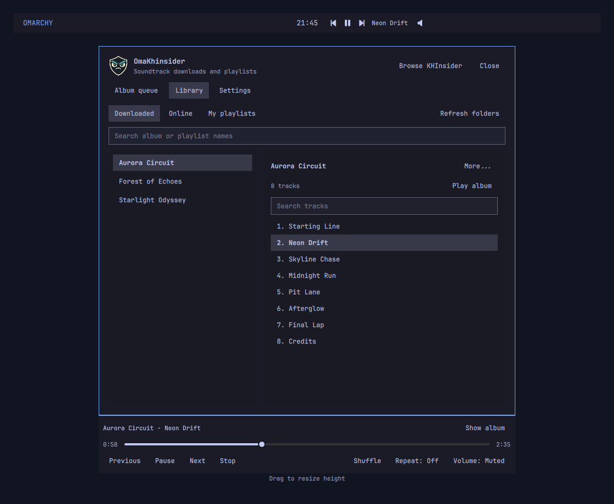

# OmaKhinsider

An Omarchy Quickshell plugin for managing KHInsider soundtrack downloads and playlists.

The plugin provides an installable Quickshell bar widget and panel with a persistent album queue, browser-assisted album inspection, sequential audio downloads, and online or local playlist playback. Settings lets you choose the download folder and MP3 or FLAC. There is no Electron or embedded browser, and no npm or Python packages are required. Browsing and inspection use your existing native Chromium or Firefox browser. Playback uses Qt 6 Multimedia and its FFmpeg backend, included with Omarchy.



## Install

With a running Omarchy shell:

```sh
omarchy plugin add https://github.com/kelmankenberg/OmaKhinsider --enable
omarchy bar put kelmankenberg.omakhinsider
```

Read the runtime prerequisites below and complete **Settings > Browser setup**
before inspecting albums. Browser companion registration is a separate, manual
step. Firefox currently supports temporary developer installation only.

## Validate and test

Development checks require Make, Qt 6's `qmllint` and `qmltestrunner`, Python 3,
and Node.js (Node is only for tests, not plugin runtime). The feedback integration
test requires Wayland and is explicitly skipped without it; it builds an unmapped
panel and substitutes a fake browser opener, without launching a browser.

```sh
make validate
make test
```

The plugin stores its local queue and playlist definitions in
`$XDG_CONFIG_HOME/omakhinsider.json` (or `~/.config/omakhinsider.json` when
`XDG_CONFIG_HOME` is unset). Writes are atomic. Invalid data is reported and
left untouched.

## Try it locally

Runtime prerequisites: a running Omarchy Quickshell shell with Qt 6 Multimedia,
Python 3, Bash, `xdg-open`, and FFmpeg/`ffprobe`; Zenity provides the native folder
chooser (paths can also be typed). Album inspection additionally requires a
native Chromium or Firefox installation plus the companion setup below.
No npm dependencies or Python packages are needed.

Omarchy rejects symlinks inside plugin directories. Copy the project into the
user plugin directory, then validate, enable, and place the widget:

```sh
PLUGIN_ID=kelmankenberg.omakhinsider
PLUGIN_DIR="$HOME/.config/omarchy/plugins/$PLUGIN_ID"
mkdir -p "$PLUGIN_DIR"
cp -a BarWidget.qml Panel.qml AudioPlayer.qml PlayerStrip.qml StatusBanner.qml BrowserSetup.qml BarPlayer.qml Model.js manifest.json README.md LICENSE i18n backend icons browser-companion "$PLUGIN_DIR/"
omarchy plugin validate "$PLUGIN_DIR"
omarchy plugin enable "$PLUGIN_ID"
omarchy bar put "$PLUGIN_ID"
```

Open the panel from the bar. It can also be summoned with
`omarchy-shell shell summon kelmankenberg.omakhinsider '{}'`.

Drag **Drag to resize height** at the bottom of the panel to adjust its height.
The height is saved across sessions. It is always capped to the current screen's
usable height, including after a display change; a taller saved preference is
kept for when space is available again. Taller panels show more queued albums
and playlist tracks. Smaller panels scroll their contents.

## Top-bar player

In **Settings > Top-bar player**, choose **Enabled** and **Left of center** or
**Right of center**, then select **Apply bar settings**. This adds a controls-only
instance beside the clock in `centerBegin` or `centerEnd`; it does not move the KH
library icon, change the clock's center section, or create another audio player.
Fresh installations keep this feature hidden until you enable it.

Start an album from Library and close the full panel. The strip shows
Previous, Play/Pause, Next, the current track, and a volume button. It stays visible
when paused, hides after Stop or the end of an album, and remains accessible after
a playback error so you can retry. Click the title or volume button for seeking,
volume/mute, Stop, and **Show album**. Scroll over the volume button to adjust volume.
Transport controls always operate the currently active player, not a different
album selected in Library.

Position and visibility persist in `~/.config/omarchy/shell.json` as an additional
`kelmankenberg.omakhinsider` entry with `"view": "player"` and `playerEnabled`.
Changing them does not modify `omakhinsider.json` or your music. **Hidden** keeps
the preferred position saved. Changing sides preserves playback and unrelated bar
entries. The feature uses Omarchy's ordinary widget layout and local property
bindings, not background polling or an extra browser/runtime.

## Feedback and support

Open **Settings > Feedback and support > Request a feature / Report a bug** to
open the repository's GitHub issue-form chooser in your default browser. Check
existing issues before submitting; a GitHub account is needed to create an issue.
The plugin does not automatically attach diagnostics, music paths, or library data.
Maintainers can configure feature-request and bug-report templates in the
repository; the link uses the chooser and does not depend on template filenames.

## Browser companion

**Installing the plugin alone does not connect your browser.** Open
**Album queue > Setup instructions** or **Settings > Browser setup** for the
bundled, offline guide. It includes commands using your actual plugin location
and generates Chromium registration commands after you paste the extension ID.
No setup command runs automatically. No sudo or pkexec is required.
Downloaded albums can be imported and played without the companion.

The browser companion sends the current KHInsider album URL to OmaKhinsider
through Omarchy shell IPC, opens the panel, and fills the album URL field.
Its separate **Inspect album for downloads** action reads the selected album's
track list and makes ordinary same-origin requests for its track pages in that
browser tab. It uses the browser's existing session without exporting cookies.
Inspection stops on access errors; it does not bypass site checks. Only the
selected KHInsider page is accessible through `activeTab` and `scripting`.

The installer supports **native Chromium and Firefox**. Chrome, Brave, Flatpak,
and other sandboxed browser packages are not configured by this installer;
they use different registration locations or host-access restrictions.

### Chromium setup

1. In a terminal, change to your installed plugin directory (or source checkout)
   and build the extension:

   ```sh
   cd "$HOME/.config/omarchy/plugins/kelmankenberg.omakhinsider"
   ./browser-companion/build-extension.sh chromium
   ```

2. Open `chrome://extensions` in Chromium, enable **Developer mode**, and select
   **Load unpacked**. Select the generated `browser-companion/build/chromium`
   folder inside that plugin directory. Pin OmaKhinsider in the browser toolbar.
3. Copy OmaKhinsider's **ID** from `chrome://extensions`: 32 lowercase letters
   from `a` to `p`. In the plugin's **Browser setup** guide, paste that ID and
   copy/run its registration command. Alternatively, in the same terminal,
   replace the quoted placeholder below with the real ID before running:

   ```sh
   ./browser-companion/install-native-host.sh chromium 'PASTE_YOUR_32_LETTER_EXTENSION_ID_HERE'
   ```

   The installer rejects placeholder or malformed IDs. It authorizes only this
   extension ID. If you move the extension directory or its ID changes, register
   the new ID.

### Firefox developer setup

**This is temporary, not persistent end-user distribution.** The current
unsigned extension disappears when Firefox restarts. Repeat the temporary
loading step each session. Persistent installation in normal Firefox requires
a Mozilla-signed extension, which this project does not yet distribute.

1. Build from the installed plugin directory (or source checkout):

   ```sh
   cd "$HOME/.config/omarchy/plugins/kelmankenberg.omakhinsider"
   ./browser-companion/build-extension.sh firefox
   ```

2. Open `about:debugging#/runtime/this-firefox`, choose **Load Temporary Add-on**,
   and select `browser-companion/build/firefox/manifest.json`.
3. Register the fixed Firefox extension ID:

   ```sh
   ./browser-companion/install-native-host.sh firefox
   ```

   The fixed ID is `omakhinsider@kelmankenberg.github.io`; no ID argument is needed.
   Open the companion through Firefox's Extensions menu.

### Verify the connection

Open the browser companion and select **Test plugin connection**. It must report
**Connected to OmaKhinsider**. This checks browser native messaging, the registered
Python host, Omarchy shell IPC, and plugin readiness. It needs no album page,
does not add anything to the queue/library, and does not inspect or download music.
It does **not** test access to KHInsider or its audio servers.

To try inspection, open an album page such as
<https://downloads.khinsider.com/game-soundtracks/album/mass-effect>, then select
**Inspect album for downloads** in the companion and keep the tab on that album.
The inspected album appears automatically in **Album queue**. Choose **Download**
or **Save for streaming** there.

**Send to Album Queue** is different: it only fills the URL field and opens the
plugin. Select **Add album** to queue the URL without inspection.

### Troubleshooting and updates

| Symptom | Action |
| --- | --- |
| Cannot connect to native host / host not found / forbidden | Rerun registration for the correct browser and current Chromium ID. Confirm Python 3 is installed and the host file is executable. Close/reopen the popup. Unsupported browser packages need their own registration setup. |
| Plugin unavailable | Ensure the Omarchy shell is running and OmaKhinsider is enabled. Open its panel and resolve any library-load error. |
| Still loading | Wait for the library to load; resolve any displayed state-file error before retrying. |
| Invalid request / versions differ | Rebuild and reload the extension, then rerun native-host registration to update the Python host. |
| Inspection disabled | Open an album's main page, not a track page or the site's home page, then reopen the popup. |
| Inspection fails after a successful connection test | Complete normal site checks in that browser and keep the same album tab open. Inspect again; the companion does not bypass access restrictions. |
| Firefox companion missing after restart | Reload its temporary add-on. This is expected for the current unsigned development build. |

After updating companion files or permissions, rebuild and reload the extension
in the browser's extension manager, and rerun native-host registration.
Registration installs the shared executable at
`${XDG_DATA_HOME:-~/.local/share}/omakhinsider/native-host.py`. The registrations
are:

- Chromium: `${XDG_CONFIG_HOME:-~/.config}/chromium/NativeMessagingHosts/org.omarchy.omakhinsider.json`
- Firefox: `~/.mozilla/native-messaging-hosts/org.omarchy.omakhinsider.json`

### Remove the browser companion

Remove OmaKhinsider in each browser's extension manager. Delete only the
registration for browsers from which you are removing the companion:

```sh
# Chromium registration:
rm -f -- "${XDG_CONFIG_HOME:-$HOME/.config}/chromium/NativeMessagingHosts/org.omarchy.omakhinsider.json"
# Firefox registration:
rm -f -- "$HOME/.mozilla/native-messaging-hosts/org.omarchy.omakhinsider.json"
```

Only after removing the companion from **all** browsers, remove the shared host:

```sh
rm -f -- "${XDG_DATA_HOME:-$HOME/.local/share}/omakhinsider/native-host.py"
```

Do not delete the whole `omakhinsider` data/config folders: downloaded music,
portable album manifests, and `omakhinsider.json` are not part of companion
removal. Browser setup never moves or deletes music.

## Downloading and playback

For downloads:

1. Open **Settings** in the plugin, use **Browse...** to choose a download folder
   (or enter its path), select MP3 or FLAC
   as the preferred format, and select **Save settings**. The default is
   `~/Music/OmaKhinsider`.
   Browse uses Omarchy's installed Zenity folder chooser. Choosing a folder does
   not change the saved location until you select **Save settings**.
2. Select **Inspect album** on a queued album, then open the browser companion and
   select **Inspect album for downloads**. Keep the album tab open. Requests are
   sequential, spaced one second apart; the extension badge and popup show progress.
   The popup may be closed while inspection continues.
3. When inspection finishes, the plugin shows the album title, track count, and
   available download formats. MP3-only albums are labeled and automatically
   download as MP3, even when FLAC is preferred. Each album uses one format
   supported by every track; the preferred format is used whenever available.
   **More... > Tracks** shows discovered titles and formats; **Download** starts
   the album. **Download ready albums** processes inspected, compatible albums in
   queue order, one at a time, leaving uninspected or incompatible albums queued.
   The primary action changes from **Inspect album** to **Download**, or
   **Retry download** after a failure or cancellation. Failed albums stay queued with
   their error while the batch continues with the remaining albums.
4. **Cancel** stops a download. Retrying verifies completed tracks against their
   saved hashes and skips them. An interrupted individual track restarts from zero.
   During a batch, **Cancel all** (or the active album's **Cancel**) stops the
   batch; unfinished albums stay queued.

On success, the album is removed from the queue and added to **Library** in a
single atomic library update. Its album view shows downloaded tracks, with the
format and folder under **More... > Details**; local paths are used for playback. Retrying a
previously downloaded album updates its existing album/format playlist rather
than creating duplicates. Deleting a playlist never deletes its audio files.

The **Library** tab separates **Downloaded**, **Online**, and **My playlists**
(existing custom lists), with album-name search and track search. Multi-disc
albums display disc headings, and filtered tracks retain their original playback
positions. Use **More...** for contextual rename, details, refresh, relink, and
**Remove from library** actions. New custom lists are created only in **My playlists**.

Select an album and choose **Play album**, or select a track to start there.
The compact bottom player remains visible across every tab and provides
play/pause, stop, previous/next, seeking, shuffle, and repeat (off, all, or one).
Select its volume button to reveal volume/mute controls. **Show album** returns
to the currently playing album. Transport Play/Pause always controls current
playback, not a different selected album. Tracks advance automatically.
Playback continues when the panel closes or another tab opens. Selecting another
album does not interrupt playback until you choose **Play album** or a track.
Deleting the playing playlist stops playback but keeps its audio files. Missing
or unreadable files produce an error rather than being silently skipped.

For online albums, inspect an album as above, then select **Save for streaming**
in its queue row. The album stays in the queue and can still be downloaded.
The complete online album is saved under **Library > Online** and streams
directly from KHInsider's audio servers, without saving a permanent album
download. MP3 is preferred for streaming; FLAC is used if it is the only format
available for the whole album. Download-format settings are unchanged.

Online playlists retain the album URL, track-page URLs, and inspected media links.
If playback fails because a link expired, select **More... > Refresh inspection**, then
inspect the album using the browser companion. Reinspection updates the existing
online playlist, preserving its name; adding the same album again does not create
a duplicate. An ongoing stream is not restarted by refreshed links, and subsequent
tracks use the new links. Downloaded and online copies are independent, may share
the same name, and deleting either does not remove the other or delete audio files.

Each album gets a sanitized, source-specific subfolder. Files are written to
temporary files and published only after a complete response. Existing files are
never overwritten unless they are the plugin's own download record. Media links
and redirects are restricted to HTTPS KHInsider media hosts (`vgmsite.com` and
`vgmtreasurechest.com`). Pages and imports are limited to 2 MiB, albums to 1000
tracks, and each audio file to 2 GiB. Downloading is user-initiated, one album at
a time. If links expire or a server denies access, inspect again in the browser;
the error is displayed rather than silently bypassed.

### Portable downloaded albums

Each completed album folder contains `.omakhinsider.json`, a portable manifest
with the album title/source URL, ordered track titles, relative audio filenames,
formats, sizes, and SHA-256 checksums. It retains the download verification
records used for safe retries; incomplete downloads are marked incomplete.
MP3 and FLAC editions downloaded into the same folder are recorded separately.
Move or copy the **whole folder, including its hidden manifest**, to keep this
information with the music.

Changing the download folder in Settings automatically scans the new location.
Use **Library > Downloaded > Refresh folders** after copying or moving albums
into the current location. Complete manifests are verified and imported without
a browser or redownload. Stable album identities update relocated paths rather
than creating duplicate playlists, preserving custom playlist names. Existing
playlists outside the scanned folder are kept, as are online playlists and the
queue. An ongoing track is not restarted; subsequent tracks use refreshed paths.
There is no continuous folder watcher.

Refresh also checks saved album locations. Missing folders are labeled
**[Missing]** rather than silently removed. Select the old entry and use
**Locate folder...** to choose its replacement. Healthy albums also offer
**More... > Relink folder...**. This keeps the original playlist
name and ID, merges an already-imported copy of that folder, and preserves known
source URLs and track order when titles can be matched uniquely. The replacement
must use the same audio format; conflicting KHInsider source URLs are rejected.
Relinking updates the portable manifest but never moves, deletes, or overwrites
audio. Deleting a stale playlist remains an explicit alternative.

Older download records and external folders produce a compact discovery banner.
Select **Review** for a dedicated review view, or **Import all** to process them.
**Back to library** and **Review later** retain pending previews and do not cancel
an active import. Scrolling the workspace never hides the bottom player.
Operation feedback appears in the relevant view; completed messages can be dismissed.
Instructional text is available through **How to add albums** instead of a permanent footer.
Saved playlist metadata is reused where available; otherwise `ffprobe` (included
with Omarchy's FFmpeg) reads album/track tags, with folder names and naturally
ordered filenames as fallbacks. Review the titles and order, then choose
**Import album** or **Skip album**. Import writes a complete portable manifest
but never modifies audio. Legacy records without their original playlist cannot
prove that every original track is present; confirm the preview is complete.
Audio without KHInsider source URLs is imported as local-only tracks.

**Import all** processes every pending preview folder in sequence and shows
progress. A failed folder does not stop the remaining imports. The final summary
shows imported and failed counts; individual folder errors appear under
**Folders needing attention**, and failed previews remain available for retry.
Only successfully saved imports are removed from the review list.

Sibling `CD1`, `CD2`, `CD3` (also `Disc 1` or `Disk 1`) folders inside an album
are offered as **one multi-disc import**, ordered numerically by disc, then by
each disc's saved track order. Importing this group merges its existing disc
playlists, retaining the first disc's playlist name and ID unless a grouped
playlist already exists. The parent receives a version-2 manifest containing
safe relative paths such as `CD2/01 - Track.flac`; child manifests and all audio
remain untouched. Later scans do not import those covered discs separately.
Different formats or conflicting source albums are reported instead of silently
discarded or combined. Unrelated album folders with similar names are not grouped.

Scans include the selected directory and subfolders up to six levels deep,
limited to 200 albums and 2000 folders. Outside recognized disc groups, each
folder's audio is treated as an album. Symlinks, invalid manifests, missing/corrupt audio, and incomplete
downloads are reported instead of silently imported. The UI configuration
remains the library index and stores settings, custom names, and online playlists.

Imports are temporarily stored under `$XDG_CACHE_HOME/omakhinsider/imports` (default
`~/.cache/omakhinsider/imports`) and removed after processing.

## Limitations

- **My playlists** supports creating, renaming, removing, and playing existing
  custom lists, but there is not yet an in-panel control for adding tracks to
  them. Use downloaded or online album playlists for the complete playback workflow.
- Firefox companion installation is temporary and must be repeated after each
  browser restart. A Mozilla-signed persistent extension is not distributed.
- Online links can expire and require browser reinspection. Downloads and streams
  depend on normal access to KHInsider and its media servers.
- Folder discovery is manual, not a continuous watcher. Refresh after moving or
  copying folders; keep each folder's hidden manifest with its audio.

## Update or remove the plugin

For a git-managed installation:

```sh
omarchy plugin update kelmankenberg.omakhinsider
```

For a locally copied installation, repeat the copy command above. Rebuild/reload
the browser companion and rerun its host registration after companion updates.
If an updated Settings control does not appear, `omarchy restart shell` clears
cached QML; this stops current plugin playback.

To unload without removing files:

```sh
omarchy plugin disable kelmankenberg.omakhinsider
```

Remove the browser companion using the instructions above, then remove the plugin:

```sh
omarchy plugin remove kelmankenberg.omakhinsider
```

Omarchy asks for confirmation; copied installations may be moved to a backup
directory rather than deleted. Plugin removal does not delete
`omakhinsider.json`, download folders, or portable album manifests. Your library
and bar preferences are retained. Delete music or saved library data only if you
explicitly intend to discard them.

## License and usage

Plugin code and bundled artwork are licensed under the [MIT License](LICENSE).
The preview uses synthetic albums and silent test audio, not downloaded soundtracks.
OmaKhinsider is independent of KHInsider and Omarchy. This license does not grant
rights to third-party soundtracks; download or stream only content you have
permission to use and respect the source site's terms.
